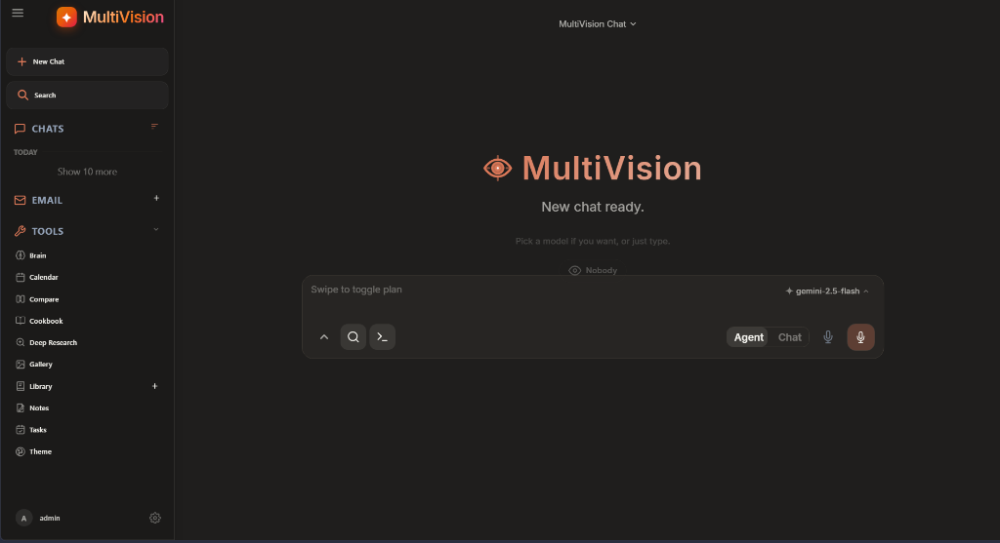

# 🔮 MultiVision AI

**MultiVision AI** is a free-first, multimodal AI control center that lets you discover, compare, route, and analyze AI models from multiple providers — all from one beautiful dashboard.



---

## ✨ Features

| Feature | Description |
|---|---|
| 🧠 **Model Intelligence** | Searchable catalog of 50+ AI models with pricing, context, quality & speed ratings |
| 📊 **Model Distribution Chart** | Live bar chart of models per provider with hide/show toggle |
| 🏆 **Best by Task** | Recommends the best model for coding, vision, reasoning, writing, and more |
| ⚖️ **Model Comparison** | Side-by-side compare any two models across all dimensions |
| ⚡ **Operations Inspector** | Live API call monitoring with latency, token usage, and status tracking |
| 💰 **Cost Analytics** | Real cost breakdown by provider, model, and task type |
| 🔮 **Multimodal Routing Lab** | Smart file router — detects image/audio/video/PDF and picks the best model |
| 🩺 **Health Analyzer** | Live diagnostic tests on all backend APIs and provider gateways |
| 📄 **Export Reports** | Download full system reports as Markdown, JSON, or CSV |
| 🛡️ **Free-First Mode** | Automatically routes to free-tier models, blocking paid ones |
| ⚙️ **Settings Panel** | Customize default startup page, chart visibility, and Free-First defaults |

---

## 🚀 Quick Start

### 1. Clone the repo
```bash
git clone https://github.com/bhanuatla521-svg/multivision-ai.git
cd multivision-ai
```

### 2. Create a virtual environment
```bash
python -m venv venv

# Windows
venv\Scripts\activate

# macOS / Linux
source venv/bin/activate
```

### 3. Install dependencies
```bash
pip install -r requirements.txt
```

### 4. Set up environment
```bash
cp .env.example .env
# Then edit .env and fill in your API keys
```

### 5. Run the server
```bash
python -m uvicorn app:app --host 127.0.0.1 --port 7000 --reload
```

### 6. Open in browser
```
http://127.0.0.1:7000/ai-models
```

---

## 🔑 Free API Keys

You need at least one of these to use AI models:

| Provider | Free Tier | Sign Up |
|---|---|---|
| **Hugging Face** | ~1,000 requests/day | [huggingface.co/settings/tokens](https://huggingface.co/settings/tokens) |
| **Google Gemini** | 1,500 requests/day | [aistudio.google.com/apikey](https://aistudio.google.com/apikey) |
| **NVIDIA NIM** | 1,000 free credits | [build.nvidia.com](https://build.nvidia.com) |
| **Groq** | Very fast, free tier | [console.groq.com](https://console.groq.com) |
| **OpenRouter** | Pay-per-use, many free models | [openrouter.ai/keys](https://openrouter.ai/keys) |

---

## 🖼️ Image Generation

MultiVision AI supports image generation via:
- **Hugging Face Inference API** — Stable Diffusion 3.5, SDXL, FLUX
- **NVIDIA NIM** — SDXL, Flux, Consistency Decoder

To enable: add your API key to `.env`, then go to **Settings → AI Defaults → Image Generation** and select a model.

---

## 📁 Project Structure

```
multivision-ai/
├── app.py                  # FastAPI application entry point
├── routes/                 # API route handlers
│   ├── chat_routes.py      # Chat & image generation routing
│   ├── multivision_routes.py # MultiVision AI API endpoints
│   └── ...
├── src/                    # Core business logic
│   ├── multivision/        # MultiVision AI models & providers
│   ├── image_model_ids.py  # Image generation model detection
│   └── ...
├── static/                 # Frontend assets
│   ├── ai_control_center.html  # Main MultiVision AI dashboard
│   ├── media.html          # Multimodal media handler
│   └── ...
├── .env.example            # Environment variable template
└── requirements.txt        # Python dependencies
```

---

## 🛠️ Tech Stack

- **Backend:** Python, FastAPI, SQLite
- **Frontend:** Vanilla HTML/CSS/JavaScript (no framework dependencies)
- **AI Routing:** Custom multimodal router with Free-First mode
- **Image Generation:** Hugging Face Inference API, NVIDIA NIM

---

## 📄 License

MIT License — free to use, modify, and distribute.

---

<div align="center">
  Built with ❤️ as a free-first AI control center
</div>
