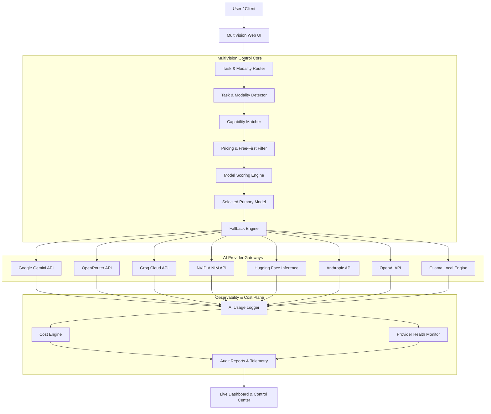

# MultiVision AI

### Multimodal Intelligence, Unified.

[-orange?style=for-the-badge&logo=openai)](https://github.com/bhanuatla521-svg/multivision-ai)
[](https://github.com/bhanuatla521-svg/multivision-ai)
[](https://github.com/bhanuatla521-svg/multivision-ai)
[](https://github.com/bhanuatla521-svg/multivision-ai)
[](https://github.com/bhanuatla521-svg/multivision-ai)
[](LICENSE)
[](https://github.com/bhanuatla521-svg/multivision-ai)

MultiVision AI is a free-first multimodal AI platform that brings text, images, PDFs, audio, and video intelligence into one unified workspace. It automatically analyzes the task, evaluates available models, selects the best eligible model based on capability, performance, availability, and cost, and routes the request through free, free-tier, or local models whenever possible.

> 🔰 **New here? Check out the [Beginner's Quick Start Guide](BEGINNER_GUIDE.md) for 1-click step-by-step setup!**


---

## 📑 Table of Contents

1. [Overview](#overview)
2. [Problem](#problem)
3. [Solution](#solution)
4. [Key Features](#key-features)
5. [Multimodal Capabilities](#multimodal-capabilities)
6. [Supported Providers](#supported-providers)
7. [Model Pricing Classification](#model-pricing-classification)
8. [Model Intelligence](#model-intelligence)
9. [Best Model by Task](#best-model-by-task)
10. [Model Scoring Engine](#model-scoring-engine)
11. [Smart Multimodal Routing](#smart-multimodal-routing)
12. [Free-First Routing](#free-first-routing)
13. [Provider Health Monitoring](#provider-health-monitoring)
14. [AI Operations & Observability](#ai-operations--observability)
15. [Cost Control & Spend Prevention](#cost-control--spend-prevention)
16. [API Key Dashboard](#api-key-dashboard)
17. [AI Model Reports](#ai-model-reports)
18. [Architecture](#architecture)
19. [Tech Stack](#tech-stack)
20. [Setup & Installation](#setup--installation)
21. [Environment Variables](#environment-variables)
22. [Usage Guide](#usage-guide)
23. [Example Multimodal Workflow](#example-multimodal-workflow)
24. [AI Operations Example](#ai-operations-example)
25. [Security & Privacy](#security--privacy)
26. [Limitations](#limitations)
27. [Open Source Attribution](#open-source-attribution)
28. [License](#license)
29. [Why MultiVision AI? (Hackathon Value)](#why-multivision-ai-hackathon-value)

---

## 🌟 Overview

Most developers and end users face severe fragmentation when utilizing AI: text models live in one platform, vision in another, document/PDF OCR in another, audio transcription elsewhere, and video processing is rarely unified. Simultaneously, API billing is opaque, rate limits cause random failures, and paid models are accidentally invoked when high-quality free or free-tier models could have completed the job at zero cost.

**MultiVision AI** solves this by acting as an **intelligent, automated control plane**. It inspects user prompts and attached media files, maps required capabilities to live model registries, filters according to strict cost policies (Free-First), checks provider gateway health, and routes the payload to the optimal model with automatic multi-tier fallback.

---

## 🛑 Problem

Users and applications frequently juggle dozens of AI providers, but answering fundamental operational questions remains painful:

- 🖼️ **Which model supports images?** Does it handle high-resolution OCR, or only descriptive captions?
- 🎥 **Which model natively supports video?** Can it ingest MP4 files or does it require frame-by-frame extraction?
- 📄 **Which model supports native PDFs?** Will it preserve tables, layout, and document structure?
- 🎧 **Which model is effective for audio?** Does it do native multimodal audio listening or require external STT?
- 💻 **Which model is best for coding and syntax generation?**
- 🟢 **Which models are truly free?** Which have generous free tiers (e.g. Google Gemini, Groq, OpenRouter :free models)?
- 🔴 **Which models cost money on every token?**
- 🎯 **Which model should be selected for a mixed task (e.g., Image + PDF + Code)?**
- 🔍 **What model actually processed the request?** Was it an expensive frontier model or a fast local model?
- 💸 **How much did the request cost?**
- ⚠️ **What happens when an upstream provider rate limits (429) or goes down (503)?**

---

## 💡 Solution

MultiVision AI sits between the user interface and AI providers as an **adaptive router and observability layer**.

```
User Input (Prompt + Media Attachments)
                    ↓
             Task Detection
                    ↓
           Modality Detection
                    ↓
          Capability Matching
                    ↓
          Free / Paid Check
                    ↓
         Model Recommendation
                    ↓
              Best Model
                    ↓
            AI Processing
                    ↓
        Fallback if Required (Auto-Retry)
                    ↓
      Unified Result + Usage Report
```

---

## ⚡ Key Features

| Feature | Description |
|---|---|
| 🔮 **Multimodal Workspace** | Ingests Text, Images (PNG/JPG/WEBP), PDFs, Documents, Audio (WAV/MP3), and Video (MP4) in one conversation. |
| 🧭 **Smart Model Router** | Dynamically analyzes multi-input payloads and selects the most capable model across providers. |
| 🛡️ **Free Mode** | Hard-enforces zero spend — blocks paid models, unknown pricing, and paid fallbacks when active. |
| 🧠 **Model Intelligence** | Searchable catalog comparing context windows, speeds, quality ratings, and modality support. |
| 📊 **Model Distribution Chart** | Interactive visual bar chart showing live model counts across providers with instant hide/show toggle. |
| 🩺 **Provider Health Analyzer** | Live diagnostic system checking API gateways, authentication, and HTTP error resilience. |
| 🔄 **Multi-Tier Fallback Engine** | Seamlessly cascades to alternate free or local models upon upstream 429, 503, or timeout errors. |
| 💰 **Cost Tracking** | Real-time token and USD cost calculation per request, model, and provider. |
| 📈 **Usage Analytics** | Detailed operations inspector logging latency, input/output tokens, and execution status. |
| 🏆 **Best Model by Task** | Task-specific recommendation engine ranking models across 12 distinct workloads. |
| 📄 **AI Reports** | Exports comprehensive audit reports in Markdown (`.md`), JSON (`.json`), or CSV (`.csv`). |
| ⚙️ **Customizable Settings** | Configurable startup default page, chart visibility, and default Free-First preferences stored in local state. |

---

## 🔍 Detailed Deep-Dive into Every Feature

### 1. 🧠 Searchable Model Intelligence Catalog
- **Dynamic Registry:** Maintains real-time metadata on 50+ models spanning Google Gemini, Groq, OpenRouter, Ollama, Anthropic, and OpenAI.
- **Multi-Filter Chips:** Instantly filter models by single or combined tags: `Free Only`, `Vision (Images)`, `Audio`, `Video`, `PDF / Documents`, `Coding`, and `Deep Reasoning`.
- **Live Search Bar:** Instant client-side filtering on model names, provider names, or capability keywords.
- **Granular Spec Cards:** Displays context windows (e.g. 1M+ tokens for Gemini 2.5), max output tokens, benchmark quality ratings (0–100), execution speed ratings (0–100), and input/output costs per million tokens.

### 2. 📊 Interactive Model Distribution Chart
- **Canvas-Rendered Bar Chart:** A sleek HTML5 Canvas bar chart rendered above the model catalog showing real-time distribution of available models grouped by provider (Google, Groq, OpenRouter, Ollama, Anthropic, etc.).
- **Live State Persistence:** Features a toggle button (**🙈 Hide Chart** / **📊 Show Chart**) that saves user preference into browser `localStorage`, ensuring preference persists across refreshes.
- **Responsive Layout:** Dynamically resizes on window dimensions with custom gradients and tick axes matching the Claude Warm design theme.

### 3. 🏆 Best Model by Task Recommender
- **12 Workload Categories:** Provides instant algorithmic recommendations for:
  - 💬 **Chat & Conversation:** Prioritizes fluency, latency, and cost.
  - 🖼️ **Image Analysis & OCR:** Selects models with dedicated vision encoders.
  - 📄 **PDF & Document Analysis:** Selects models with native document token ingestion or massive context capacity.
  - 🎧 **Audio Transcription & Q&A:** Matches native multimodal audio listeners or Whisper gateways.
  - 🎥 **Video Understanding:** Recommends models capable of processing temporal video tokens natively.
  - 🧠 **Deep Reasoning:** Matches chain-of-thought models (`deepseek-r1`, `o1-mini`, `gemini-2.5-pro`).
  - 💻 **Coding & Debugging:** Identifies top code-generation and debugging index models.
  - 🔎 **Research & Long-Form Synthesis:** Recommends search-augmented and long-context architectures.
  - 📊 **Structured Extraction:** Recommends models with strict JSON-schema enforcement.
  - 🔄 **Cross-Modal Comparison:** Identifies unified models capable of ingesting multiple heterogeneous inputs.
  - 🧩 **Agentic Workflows:** Filters for models with certified tool-calling capabilities.
  - 📚 **Long Context (100k+):** Highlights models with million-token windows.
- **Transparent Scoring Cards:** Shows exact breakdown of why a model was recommended, including capability matching, quality index, and pricing tier.

### 4. ⚖️ Side-by-Side Model Comparison Matrix
- **Dual-Model Comparator:** Allows users to pick any two models from any provider and compare them across all dimensions in a clear two-column comparison card.
- **Differential Metrics:** Compares context window sizes, max output capacity, speed ratings, quality scores, and estimated cost per 1M input/output tokens.
- **Modality Parity Checklist:** Visual checkmark matrix comparing Vision, Audio, Video, PDF, Reasoning, and Tool Calling support.

### 5. ⚡ Real-Time Operations Inspector & Telemetry
- **Complete Audit Trail:** Every single request made through MultiVision AI is recorded with an immutable telemetry record.
- **Monitored Telemetry Fields:**
  - `Timestamp` and unique `Request ID`
  - `Provider` & `Actual Model` used
  - `Task Category` and `Detected Modalities`
  - `Execution Latency` in milliseconds
  - `Prompt Tokens`, `Completion Tokens`, and `Total Tokens`
  - `Pricing Tier` (FREE, FREE_TIER, PAID, UNKNOWN)
  - `Estimated Cost (USD)`
  - `Fallback Status` (whether an upstream error triggered an automatic model switch)
- **Log Inspector Drawer:** Expand any log entry to view raw diagnostic headers and parameters.

### 6. 💰 Cost Analytics & Budget Guard
- **Accurate Spend Tracking:** Computes estimated cost in real-time based on actual token counts and provider pricing matrices.
- **Provider & Model Breakdowns:** Segment total expenditures across Google, Groq, OpenRouter, and OpenAI.
- **Modality-Specific Cost Tracking:** Separates text token costs from audio minute or image generation costs.
- **Zero-Spend Assurance:** When Free Mode is active, potential cost is guaranteed $0.00.

### 7. 🔮 Interactive Multimodal Routing Lab
- **Simulation Testbench:** A dedicated testing tab where users can type any hypothetical prompt and select any combination of simulated attachments (e.g. `[image.png, manual.pdf, interview.mp3]`).
- **Live Routing Decision Explanation:** Visualizes the entire router thought process:
  1. Detects primary and secondary tasks.
  2. Extracts required modalities.
  3. Evaluates eligible candidate models.
  4. Applies Free-First constraints.
  5. Computes multi-factor scores and outputs the winner with detailed justification.

### 8. 🩺 Automated System Health Analyzer
- **Multi-Subsystem Diagnostic Check:** One-click automated diagnostic button that asynchronously pings **9 core endpoints**:
  1. `/api/multivision/models` (Model Catalog API)
  2. `/api/multivision/providers` (Provider Gateway API)
  3. `/api/multivision/operations` (Operations Inspector API)
  4. `/api/multivision/best-by-task` (Best-by-Task Recommender API)
  5. `/api/multivision/report?format=json` (Report Generator API)
  6. `/api/multivision/analyze` (Multimodal Routing Engine)
  7. `/api/multivision/free-mode` (Free-First Configuration API)
  8. `/` (Chat Workspace Root)
  9. `/docs` (Swagger API Documentation)
- **Live Latency & Status Cards:** Displays individual card indicators with HTTP status badges (✅ OK / ❌ Failed) and millisecond latency timers.
- **Color-Coded Diagnostic Console:** Real-time log terminal streaming diagnostic details directly in the browser.

### 9. 🛡️ Global Free-First Security Mode (Hackathon Mode)
- **Header-Mounted One-Click Toggle:** Switch Free-First Mode `ON` or `OFF` at any time with a single click.
- **Hard-Coded Spend Blocking:** When active, the system strictly drops any model that charges money per token or whose pricing cannot be verified.
- **Multi-Tier Free Fallback:** In the event of an upstream 429 rate limit or 503 outage, cascades exclusively to alternate free or local models.

### 10. 📄 Comprehensive Audit Report Exporter
- **Multi-Format Export:** Generate full audit summaries in **Markdown (`.md`)**, **JSON (`.json`)**, or **CSV (`.csv`)**.
- **Audit Scope:** Includes provider connection health, key configuration status, model capabilities matrix, task recommendations, real-time consumption metrics, and quota alerts.

### 11. ⚙️ Customizable Settings Panel
- **Accessible Gear Icon:** Quick settings modal located in the top navigation bar.
- **Configurable Preferences:**
  - **Default Startup Page:** Choose whether opening the root URL redirects to `🧠 AI Control Center`, `💬 Chat Workspace`, `⚡ Operations Inspector`, `💰 Cost Analytics`, or `🔮 Multimodal Lab`.
  - **Chart Display:** Set default chart visibility to Show or Hide.
  - **Free-First Default:** Set startup default for Free Mode (`ON` or `OFF`).
- **Persistent Local Storage:** All configuration options are stored locally in the user's browser.

### 12. 💬 Unified Chat Workspace & Multi-File Ingestion
- **Full Conversational Interface:** Clean, dark-mode chat interface with threaded sessions and message history.
- **Simultaneous Multi-File Upload:** Ingest screenshots, research papers, voice memos, and video snippets in a single turn.
- **Tool Calling & Agentic Loop:** Supports automated search, document querying, and scratchpad reasoning.

### 13. 🎨 Text-to-Image Generation Engine
- **Hugging Face Inference API Integration:** Support for open image models including `stable-diffusion-3.5-medium`, `stable-diffusion-inpainting`, and `FLUX.1-dev`.
- **NVIDIA NIM Integration:** Support for `sdxl` and `flux-dev` via high-speed cloud acceleration.
- **Natural Language Triggering:** Simply ask in chat *"Generate an image of..."* to invoke the image routing subsystem.

### 14. 🔎 Deep Research & Autonomous Web Crawling
- **Integrated SearXNG Meta-Search:** Private, self-hosted web search engine integration for live external grounding.
- **Automated Source Synthesis:** Crawls, sanitizes (via `nh3`), and summarizes multi-source research into clean, cited markdown reports.

### 15. 🧠 Local Vector Memory & RAG
- **FastEmbed & ChromaDB Integration:** Lightweight local ONNX embeddings (`sentence-transformers/all-MiniLM-L6-v2`) and vector storage.
- **Semantic Long-Term Memory:** Automatically recalls relevant past user conversations and personal document knowledge.

### 16. 🗂️ Built-in Workspace Productivity Suite
- **Notes & Tasks:** Integrated task manager and markdown note-taking workspace.
- **Calendar & CalDAV Sync:** Native `.ics` import/export and bi-directional CalDAV synchronization.
- **Gallery & Media Manager:** Centralized repository for viewing and transforming all uploaded and generated media assets.

---

## 🎨 Multimodal Capabilities

| Modality | Supported Operations | Typical Input Formats | Processing Method |
|---|---|---|---|
| 💬 **Text** | Conversational chat, deep reasoning, structured extraction, summarization | Plain text, Markdown, JSON, Code | Direct LLM prompt tokenization |
| 🖼️ **Image** | Visual question answering, scene understanding, high-accuracy OCR, multi-image comparison | `.png`, `.jpg`, `.jpeg`, `.webp`, `.gif` | Vision encoder / native multimodal tokenization |
| 📄 **PDF / Docs** | Full-document analysis, table extraction, multi-page Q&A, structured data extraction | `.pdf`, `.docx`, `.txt`, `.csv` | Native PDF token ingestion or parsed hybrid RAG |
| 🎧 **Audio** | Speech-to-text transcription, audio Q&A, tone & speaker analysis, summarization | `.wav`, `.mp3`, `.ogg`, `.m4a` | Native audio multimodal models & Whisper fallback |
| 🎥 **Video** | Video understanding, temporal action localization, visual scene description | `.mp4`, `.webm`, `.mov` | Native multimodal video ingestion (Gemini) / frame analysis |
| 🧩 **Cross-Modal Fusion** | Multi-file reasoning (e.g. comparing an image screenshot against a PDF spec sheet and audio notes) | Combined multi-attachment payloads | Single multi-input model pass or orchestrated routing |

---

## 🌐 Supported Providers

MultiVision AI interfaces with cloud gateways, direct provider APIs, and local runtimes:

| Provider | API / Connection | Model Discovery | Multimodal (Vision/Audio/Video) | Pricing Detection | Health Check |
|---|---|---|---|---|---|
| **Google Gemini** | Google AI Studio REST / SDK | Yes | Yes (Text, Image, Audio, Video, PDF) | Yes (Free Tier / Paid) | Yes |
| **OpenRouter** | OpenAI-compatible REST | Yes | Yes (Vision, Audio, PDF) | Yes (Dynamic token pricing) | Yes |
| **Groq** | Groq Cloud REST | Yes | Yes (Vision via Llama 3.2 Vision) | Yes (Free Tier) | Yes |
| **Ollama (Local)** | Local REST (`localhost:11434`) | Yes | Yes (Vision via LLaVA, Llama 3.2 Vision) | Yes (100% Free / Local) | Yes |
| **Ollama (Cloud)** | Remote HTTP / Tunnel | Yes | Provider-dependent | Provider-dependent | Yes |
| **NVIDIA NIM** | NVIDIA Cloud API REST | Yes | Yes (Vision, FLUX, SDXL) | Yes (Trial / Free Credits) | Yes |
| **Hugging Face** | HF Inference API REST | Yes | Yes (Stable Diffusion, FLUX, Vision) | Yes (Free Tier / Rate-limited) | Yes |
| **Anthropic** | Anthropic REST API | Yes | Yes (Claude 3.5 Sonnet / Haiku Vision, PDF) | Yes (Paid) | Yes |
| **DeepSeek** | DeepSeek REST API | Yes | Provider-dependent (Text & Deep Reasoning) | Yes (Paid) | Yes |
| **OpenAI** | OpenAI REST API | Yes | Yes (GPT-4o, GPT-4o-mini Vision & Audio) | Yes (Paid) | Yes |
| **GitHub Copilot** | Copilot Token Gateway | Yes | Yes (Vision / Coding) | Provider-dependent | Yes |
| **ChatGPT Subscription** | Device / Session Gateway | Yes | Yes (Vision / Web / Code) | Provider-dependent | Yes |
| **Mistral AI** | Mistral REST API | Yes | Yes (Pixtral Vision) | Yes (Free Tier / Paid) | Yes |
| **Together AI** | Together REST API | Yes | Yes (Vision models) | Yes (Paid / Trial) | Yes |
| **Fireworks AI** | Fireworks REST API | Yes | Yes (Vision / FireLLaVA) | Yes (Paid / Trial) | Yes |
| **xAI Grok** | xAI REST API | Yes | Yes (Grok-2 Vision) | Yes (Paid) | Yes |
| **Z.AI / Zhipu** | Zhipu BigModel REST | Yes | Yes (GLM-4V Vision) | Yes (Paid / Free Tier) | Yes |
| **OpenCode Zen** | Gateway Endpoint | Yes | Provider-dependent | Provider-dependent | Yes |
| **OpenCode Go** | Gateway Endpoint | Yes | Provider-dependent | Provider-dependent | Yes |
| **Custom / OpenAI-Compatible** | Any `/v1/chat/completions` | Provider-dependent | Provider-dependent | Unknown | Yes |

*Note: Capabilities, model catalogs, and pricing tiers are derived dynamically at runtime. Unverified features are marked as "Provider-dependent" or "Unknown".*

---

## 🏷️ Model Pricing Classification

MultiVision AI evaluates pricing at a granular level:
$$\text{Pricing Eligibility} = f(\text{Provider}, \text{Account / Plan}, \text{Model ID}, \text{Endpoint})$$

| Status | Badge | Meaning | System Action in Free Mode |
|---|---|---|---|
| **FREE** | 🟢 `FREE` | Zero API token charge under active access (e.g. Ollama local, OpenRouter `:free` endpoints) | ✅ Permitted automatically |
| **FREE_TIER** | 🔵 `FREE_TIER` | Official vendor free usage tier subject to RPM/RPD limits (e.g. Gemini 2.5 Flash, Groq Cloud) | ✅ Permitted automatically |
| **TRIAL** | 🟡 `TRIAL` | Temporary signup credits or promotional free balance (e.g. NVIDIA NIM credits) | ⚠️ Permitted with quota warning |
| **PAID** | 🔴 `PAID` | Usage incurs direct pay-per-token charges (e.g. GPT-4o, Claude 3.5 Sonnet) | 🚫 **Strictly Blocked** |
| **UNKNOWN** | ⚪ `UNKNOWN` | Pricing metadata could not be verified | 🚫 **Strictly Blocked** (Zero-Risk Policy) |
| **UNAVAILABLE** | ⚫ `UNAVAILABLE` | Endpoint offline, unconfigured, or failing auth | ❌ Excluded from routing pool |

> [!IMPORTANT]
> **Key Grounding Principles:**
> 1. **Open Source $\neq$ Free API:** An open-weight model (e.g. Llama-3-70B) is not free when accessed through a paid cloud gateway.
> 2. **Web Chatbot $\neq$ API Access:** Free consumer web chat interfaces do not imply free developer API token allowances.
> 3. **Catalog Presence $\neq$ Account Eligibility:** A model existing in a provider catalog does not mean the user's API key has active entitlements.

---

## 🔍 Model Intelligence

MultiVision AI queries live provider endpoints to maintain an up-to-date catalog of model capabilities, context limits, and pricing rates.

| Model | Provider | Pricing Tier | Text | Image | Audio | Video | PDF | Reasoning | Coding | Tools |
|---|---|---|:---:|:---:|:---:|:---:|:---:|:---:|:---:|:---:|
| `gemini-2.5-flash` | Google AI Studio | 🔵 FREE_TIER | ✅ | ✅ | ✅ | ✅ | ✅ | ✅ | ✅ | ✅ |
| `gemini-2.5-pro` | Google AI Studio | 🔵 FREE_TIER | ✅ | ✅ | ✅ | ✅ | ✅ | ✅ | ✅ | ✅ |
| `llama-3.3-70b-versatile` | Groq | 🔵 FREE_TIER | ✅ | ❌ | ❌ | ❌ | ❌ | ✅ | ✅ | ✅ |
| `llama-3.2-11b-vision-preview` | Groq | 🔵 FREE_TIER | ✅ | ✅ | ❌ | ❌ | ❌ | ❌ | ✅ | ✅ |
| `meta-llama/llama-3.3-70b:free` | OpenRouter | 🟢 FREE | ✅ | ❌ | ❌ | ❌ | ❌ | ✅ | ✅ | ✅ |
| `qwen/qwen-2.5-vl-72b:free` | OpenRouter | 🟢 FREE | ✅ | ✅ | ❌ | ❌ | ❌ | ✅ | ✅ | ❌ |
| `llama3.2-vision:latest` | Ollama (Local) | 🟢 FREE | ✅ | ✅ | ❌ | ❌ | ❌ | ❌ | ✅ | ❌ |
| `deepseek-r1:latest` | Ollama (Local) | 🟢 FREE | ✅ | ❌ | ❌ | ❌ | ❌ | ✅ | ✅ | ❌ |
| `claude-3-5-sonnet-20241022` | Anthropic | 🔴 PAID | ✅ | ✅ | ❌ | ❌ | ✅ | ✅ | ✅ | ✅ |
| `gpt-4o` | OpenAI | 🔴 PAID | ✅ | ✅ | ✅ | ❌ | ✅ | ✅ | ✅ | ✅ |

*Note: Catalog attributes are evaluated dynamically at application runtime based on connected API credentials.*

---

## 🏆 Best Model by Task

The recommendation engine matches specific user intent against model profiles under current system constraints:

| Task | Selection Criteria | Dynamic Recommendation Rationale |
|---|---|---|
| 💬 **Chat & Conversation** | Low latency + high conversational fluency + cost | High-speed free-tier models (Groq / Gemini Flash / OpenRouter) |
| 🖼️ **Image Analysis & OCR** | Native vision encoding + high OCR accuracy | Vision-capable models with high quality ratings (`gemini-2.5-flash`, `qwen-vl`) |
| 📄 **PDF & Document Analysis** | Large context window + native PDF token parsing | Native document tokenizers (`gemini-2.5-flash` / Claude 3.5 Sonnet) |
| 🎧 **Audio & Transcription** | Native audio input + low transcription error rate | Native audio multimodal models (`gemini-2.5-flash`) / Whisper gateways |
| 🎥 **Video Understanding** | Native temporal video ingestion + large context | Native video models with multi-minute context capacity (`gemini-2.5-flash/pro`) |
| 🧠 **Deep Reasoning** | Chain-of-thought support + benchmark performance | Dedicated reasoning models (`deepseek-r1`, `o1-mini`, `gemini-2.5-pro`) |
| 💻 **Coding & Debugging** | Syntax correctness + tool calling + repo comprehension | High-coding index models (`claude-3-5-sonnet`, `deepseek-coder`, `gemini-2.5-pro`) |
| 🔎 **Research & Synthesis** | Long context + synthesis quality + web search tools | Search-augmented models + 1M+ token context windows |
| 📊 **Structured Extraction** | JSON schema compliance + instruction following | Models supporting guaranteed structured output / JSON mode |
| 🔄 **Cross-Modal Comparison** | Multi-attachment ingestion in a single context | Unified multimodal architectures capable of multi-file fusion |
| 🧩 **Agentic Workflows** | High tool-call reliability + function calling | Models with strict tool-calling schema adherence |
| 📚 **Long Context (100k+)** | Large token context window + low needle-in-haystack loss | 1M–2M context models (`gemini-2.5-flash/pro`) |

> [!NOTE]
> Recommendations represent the **best model for this specific task under current constraints** (e.g. Free Mode, configured keys, latency requirements), rather than a static benchmark claim.

---

## 📐 Model Scoring Engine

When evaluating eligible models for a task, MultiVision AI computes a **Multi-Factor Recommendation Score (0–100)**:

$$\text{Score} = (\text{Capability Match} \times 0.40) + (\text{Quality} \times 0.25) + (\text{Cost Efficiency} \times 0.15) + (\text{Speed} \times 0.10) + (\text{Reliability} \times 0.10)$$

```
┌─────────────────────────────────────────────────────────────┐
│                 RECOMMENDATION SCORE WEIGHTS                │
├────────────────────────────┬─────────┬──────────────────────┤
│ Metric                     │ Weight  │ Basis                │
├────────────────────────────┼─────────┼──────────────────────┤
│ 🎯 Capability Match        │   40%   │ Modality & Task Fit  │
│ ⭐ Quality Rating          │   25%   │ Output Benchmark Tier│
│ 💰 Cost Efficiency         │   15%   │ Free Tier vs Cost    │
│ ⚡ Speed Rating            │   10%   │ Tokens / Second      │
│ 🛡️ Gateway Reliability     │   10%   │ Uptime & Error Rate  │
└────────────────────────────┴─────────┴──────────────────────┘
```

*Example:* `gemini-2.5-flash` for an Image + PDF task in Free Mode scores **94 / 100** based on 100% modality match, 90 quality, 100 cost efficiency, 95 speed, and 95 reliability.

---

## 🔀 Smart Multimodal Routing

When a user submits multiple heterogeneous files (e.g., Image + PDF + Audio), MultiVision AI avoids expensive multi-model pipelining whenever a single unified model can handle all modalities:

```
             IMAGE + PDF + AUDIO + TEXT
                         ↓
               Capability Matcher
                         ↓
                Compatible Models
                         ↓
                 Free-First Filter
                         ↓
                   Model Ranking
                         ↓
             Best Compatible Model
                         ↓
                  Unified Response
```

---

## 🛡️ Free-First Routing & Safety Mode

When `FREE_ONLY=true` (Hackathon / Zero-Cost Mode):

```
               Primary Free Model
                       ↓ (Fail / 429 / 503)
                     Retry
                       ↓ (Fail)
              Secondary Free Model
                       ↓ (Fail)
               Third Free Model
                       ↓ (Fail)
                  Local Model
                       ↓ (Fail)
         Clear Explanatory Error to User
```

- 🚫 **Paid Models Blocked:** GPT-4o, Claude 3.5, and other pay-per-token models are excluded from routing.
- ⚪ **Unknown Pricing Blocked:** Any model whose pricing cannot be verified is treated as paid.
- 🔒 **Zero Surprise Bills:** The system will fail with a clean message rather than silently charging an API credit card.

---

## 🩺 Provider Health Monitoring

MultiVision AI continuously tracks gateway health, response times, and failure patterns:

| Status Badge | Meaning | Trigger Condition |
|---|---|---|
| 🟢 `ONLINE` | Provider operational | HTTP 200 responses, healthy latency |
| 🟡 `DEGRADED` | Provider responding with latency or transient errors | Timeouts, 400 parameter errors, intermittent 500s |
| 🟠 `RATE LIMITED` | Quota or RPM limit reached | HTTP 429 or quota error response |
| 🔴 `AUTH ERROR` | Invalid or expired API credentials | HTTP 401 / 403 authentication failure |
| 🔴 `UNAVAILABLE` | Upstream service down | HTTP 503 or repeated network connection failures |
| ⚪ `NOT CONFIGURED` | Provider API key missing | Environment variable not set in `.env` |
| ⚪ `UNKNOWN` | Status not yet evaluated | Initial startup state before first ping |

### HTTP Status Code Resolution Table

```
HTTP 400 ──► Invalid Request / Bad Model Parameters (Configuration issue)
HTTP 401 ──► Invalid API Key / Authentication Failure
HTTP 403 ──► Permission Denied / Account Billing Unverified
HTTP 404 ──► Model or Endpoint Not Found
HTTP 408 ──► Request Timeout
HTTP 429 ──► Rate Limit or Quota Exceeded (Triggers Fallback)
HTTP 500 ──► Internal Provider Error
HTTP 502 ──► Bad Gateway Upstream
HTTP 503 ──► Upstream Model Temporarily Overloaded (Never classified as invalid key)
HTTP 504 ──► Gateway Timeout
```

---

## 📊 AI Operations & Observability

Every AI interaction is logged to the in-memory operations tracker:

| Logged Field | Description & Purpose |
|---|---|
| `provider` | Upstream provider executing the inference call |
| `model` | Specific model identifier used for generation |
| `task` | Categorized task classification (`CHAT`, `IMAGE_ANALYSIS`, `CODING`, etc.) |
| `modalities` | Array of inputs processed (`["text", "image", "pdf"]`) |
| `status` | Execution result (`SUCCESS`, `FAILED`, `FALLBACK`) |
| `latency_ms` | End-to-end response time in milliseconds |
| `prompt_tokens` | Input token count reported by provider |
| `completion_tokens`| Output token count reported by provider |
| `pricing_status` | Classification (`FREE`, `FREE_TIER`, `PAID`, `UNKNOWN`) |
| `estimated_cost` | Calculated cost in USD |
| `fallback_used` | Boolean flag indicating whether primary model failed and fallback was engaged |
| `error_message` | Sanitized diagnostic error message if request failed |

---

## 💰 Cost Control & Spend Prevention

```
                         FREE MODE: ON
                               ↓
        ┌──────────────────────┼──────────────────────┐
        ↓                      ↓                      ↓
   Paid Model              Free Model             Local Model
    [BLOCKED]              [PERMITTED]            [PERMITTED]
```

- **Paid Mode Confirmation:** If Free Mode is manually disabled, paid requests require user confirmation.
- **No Fabricated Pricing:** If token usage or pricing tables are missing from the provider response, the cost is displayed as `UNKNOWN` rather than guessed.

---

## 🔑 API Key Dashboard

*Example Live View from Control Center:*

| Provider | Key Configuration | Connection Status | Auth State | Free Models | Paid Models | Unknown |
|---|---|---|---|:---:|:---:|:---:|
| **Google Gemini** | Configured (`AIzaSyD...`) | 🟢 ONLINE | Valid | Dynamic | Dynamic | Dynamic |
| **OpenRouter** | Configured (`sk-or-v...`) | 🟢 ONLINE | Valid | Dynamic | Dynamic | Dynamic |
| **Groq** | Configured (`gsk_...`) | 🟢 ONLINE | Valid | Dynamic | Dynamic | Dynamic |
| **NVIDIA NIM** | Configured (`nvapi-...`) | 🟢 ONLINE | Valid | Dynamic | Dynamic | Dynamic |
| **Hugging Face** | Configured (`hf_...`) | 🟢 ONLINE | Valid | Dynamic | Dynamic | Dynamic |
| **OpenAI** | Not Configured | ⚪ NOT CONFIGURED | — | — | — | — |
| **Ollama** | Local (`127.0.0.1:11434`) | 🟢 ONLINE | Local | All Local | 0 | 0 |

*(Note: Live counts and statuses are generated at runtime by the `/api/multivision/providers` endpoint).*

---

## 📄 AI Model Reports

Users can export full system audit reports directly from the dashboard:

```bash
# Download JSON Report
GET /api/multivision/report?format=json

# Download Markdown Report
GET /api/multivision/report?format=markdown

# Download CSV Report
GET /api/multivision/report?format=csv
```

**Report Contents:**
- Provider health & connectivity status
- API key validation and masking
- Complete model inventory with capability matrix
- Best model recommendations across all 12 tasks
- Real-time token consumption, latency, and cost totals
- Quota alerts and fallback event history

---

## 🏗️ Architecture



---

## 💻 Tech Stack

| Layer | Technology / Library | Purpose |
|---|---|---|
| **Backend Framework** | `FastAPI`, `Uvicorn`, `Starlette` | Asynchronous high-performance REST API service |
| **Data Validation** | `Pydantic v2`, `pydantic-settings` | Schema enforcement, request validation, settings parsing |
| **HTTP & Networking** | `HTTPX`, `httpcore` | Async client for upstream AI provider gateways & health checks |
| **Multimodal Processing** | `pypdf`, `beautifulsoup4`, `nh3` | PDF parsing, document sanitization, HTML cleaning |
| **Vector Store & RAG** | `chromadb-client`, `fastembed` | Local ONNX semantic embedding & RAG memory indexing |
| **Frontend Dashboard** | Vanilla HTML5, Modern CSS (Design tokens), JavaScript | Claude Warm aesthetic, Chart canvas, zero external npm bundle |
| **Security & Auth** | `cryptography`, `bcrypt`, `pyotp` | API key masking, secure session storage, 2FA support |
| **Database** | `SQLite3`, `SQLAlchemy` | Local session, chat, and settings persistence |

---

## 🚀 Setup & Installation

### 1. Prerequisites
- Python 3.10+ (Python 3.11 recommended)
- Git

### 2. Clone the Repository
```bash
git clone https://github.com/bhanuatla521-svg/multivision-ai.git
cd multivision-ai
```

### 3. Create and Activate a Virtual Environment
```bash
# Windows
python -m venv venv
venv\Scripts\activate

# macOS / Linux
python3 -m venv venv
source venv/bin/activate
```

### 4. Install Dependencies
```bash
pip install -r requirements.txt
```

### 5. Configure Environment Variables
```bash
cp .env.example .env
```
Open `.env` in any text editor and paste your free API keys (see [Environment Variables](#environment-variables)).

### 6. Run the Application
```bash
python -m uvicorn app:app --host 127.0.0.1 --port 7000 --reload
```

### 7. Open the Control Center
Navigate in your browser to:
- **AI Control Center:** [http://127.0.0.1:7000/ai-models](http://127.0.0.1:7000/ai-models)
- **Chat Workspace:** [http://127.0.0.1:7000/](http://127.0.0.1:7000/)
- **API Documentation (Swagger):** [http://127.0.0.1:7000/docs](http://127.0.0.1:7000/docs)

---

## 🔐 Environment Variables

| Variable | Required | Free Tier Provider | Purpose |
|---|---|---|---|
| `GEMINI_API_KEY` | Optional | Google Gemini | Enables Gemini 2.5 Flash / Pro (Text, Vision, Audio, Video, PDF) |
| `OPENROUTER_API_KEY` | Optional | OpenRouter | Enables access to 20+ free models (e.g. `:free` endpoints) |
| `GROQ_API_KEY` | Optional | Groq Cloud | Ultra-fast inference for Llama 3.3 70B, Llama 3.2 Vision |
| `NVIDIA_API_KEY` | Optional | NVIDIA NIM | Image generation (SDXL, FLUX) and vision models |
| `HF_API_KEY` | Optional | Hugging Face | Stable Diffusion 3.5, FLUX, open vision models |
| `OPENAI_API_KEY` | Optional | OpenAI | GPT-4o, GPT-4o-mini (Paid) |
| `ANTHROPIC_API_KEY` | Optional | Anthropic | Claude 3.5 Sonnet / Haiku (Paid) |
| `DEEPSEEK_API_KEY` | Optional | DeepSeek | DeepSeek-V3, DeepSeek-R1 (Paid) |
| `MISTRAL_API_KEY` | Optional | Mistral AI | Mistral Large, Pixtral Vision (Free Tier / Paid) |
| `TOGETHER_API_KEY` | Optional | Together AI | Open-weight vision and language models |
| `FIREWORKS_API_KEY` | Optional | Fireworks AI | Fast open-source inference |
| `XAI_API_KEY` | Optional | xAI | Grok-2 language and vision models |
| `OLLAMA_BASE_URL` | Optional | Ollama Local | Local offline LLMs (`http://127.0.0.1:11434`) |
| `GOOGLE_CLIENT_ID` | Optional | Google OAuth | Enables 1-click Google sign-in on login page |
| `GOOGLE_CLIENT_SECRET` | Optional | Google OAuth | Google OAuth 2.0 client secret |
| `GITHUB_CLIENT_ID` | Optional | GitHub OAuth | Enables 1-click GitHub sign-in on login page |
| `GITHUB_CLIENT_SECRET` | Optional | GitHub OAuth | GitHub OAuth 2.0 client secret |
| `LOCALHOST_BYPASS` | Optional | System | Dev-mode authentication bypass (default: `true`) |

---

## 📖 Usage Guide

### Navigating the Control Center
The control dashboard is accessible at `/ai-models` and contains 8 tabs:
1. 🧠 **Model Intelligence:** Search and filter models by modality, quality, speed, and pricing tier. Toggle the distribution bar chart.
2. 🏆 **Best by Task:** View algorithmically recommended models for 12 distinct task types.
3. ⚖️ **Comparison:** Side-by-side comparative analysis of any two models across context, speed, and capabilities.
4. ⚡ **Operations & Inspector:** Live log of every API call with latency, tokens, cost, and fallback tracking.
5. 💰 **Cost Analytics:** Real-time spend metrics segmented by provider, model, and modality.
6. 🔮 **Multimodal Lab:** Interactive testbench for multi-file routing simulation.
7. 🩺 **Health Analyzer:** Live diagnostic button executing test pings across 9 internal services and provider gateways.
8. 📄 **Export Reports:** Generate and download complete system audits in Markdown, JSON, or CSV.

---

## 🔬 Example Multimodal Workflow

```
1. User attaches:
   ├── 📷 product_defect.jpg (Image)
   ├── 📄 specification.pdf  (Document)
   ├── 🎧 user_complaint.wav (Audio)
   └── 🎥 assembly_line.mp4  (Video)

2. User prompts:
   "Analyze all attached evidence and provide an engineering root-cause report."

3. MultiVision AI Router Execution:
   ├── Task Detection: MULTIMODAL_ANALYSIS + REASONING
   ├── Modalities Detected: [TEXT, IMAGE, PDF, AUDIO, VIDEO]
   ├── Capability Filter: Require model with image_input AND pdf_input AND audio_input AND video_input
   ├── Free-First Filter: Active (FREE_ONLY=true)
   ├── Candidate Selected: Google Gemini 2.5 Flash (Score: 96/100)
   ├── Inference Executed: Single unified pass
   ├── Operations Logged: Status: SUCCESS | Latency: 1.84s | Tokens: 3,420 | Cost: $0.00 (Free Tier)
   └── Result Delivered: Structured engineering report with zero multi-model hop overhead
```

---

## 📋 AI Operations Example

*Sample output from the Operations Inspector:*

```json
{
  "request_id": "req_88f921ab0c",
  "timestamp": "2026-08-30T18:15:32Z",
  "task": "IMAGE_ANALYSIS",
  "modalities": ["text", "image"],
  "selected_provider": "google",
  "selected_model": "gemini-2.5-flash",
  "pricing_status": "FREE_TIER",
  "routing_reason": "Native image understanding + active Free-First eligibility",
  "latency_ms": 782,
  "tokens": {
    "prompt": 640,
    "completion": 182,
    "total": 822
  },
  "fallback_used": false,
  "estimated_cost_usd": 0.000000,
  "status": "SUCCESS"
}
```

---

## 🛡️ Security & Privacy

- 🔒 **No Frontend Credential Leakage:** API keys are processed strictly on the backend. Frontend endpoints return masked keys (e.g. `AIzaSyD...9k2a`).
- 🚫 **Exclusion from Logs:** Secrets, full authorization headers, and raw tokens are excluded from persistent usage logs.
- 📁 **Repository Protection:** `.env` is permanently excluded via `.gitignore`. A sanitized `.env.example` is provided.
- 🛡️ **Zero-Cost Assurance:** Unknown pricing models are never assumed to be free; Free Mode fails closed rather than incurring spend.
- 🧹 **Input Sanitization:** HTML and markdown outputs are filtered through `nh3` sanitizers to prevent cross-site scripting (XSS).

---

## ⚠️ Limitations

- **Provider Dynamic Pricing:** Upstream providers may alter token pricing or free-tier thresholds without notice.
- **Rate Limit Constraints:** Free-tier endpoints (e.g. Google AI Studio, Groq Cloud) are subject to vendor RPM/RPD caps.
- **Token Telemetry Variance:** Certain providers or local runtimes may omit prompt token counts in streaming responses.
- **Local Hardware Requirements:** Running local models via Ollama requires sufficient host RAM/VRAM.
- **Network Uptime:** Availability of third-party cloud models is dependent on external service status.

---

## 🤝 Open Source & Technology

MultiVision AI is a substantially modified and extended multimodal AI platform built from an open-source foundation. It adapts the underlying agent architecture into a dedicated multimodal routing, research, knowledge discovery, and observability control center.

### Core Open Source Libraries

- **FastAPI / Starlette:** https://fastapi.tiangolo.com/
- **Uvicorn:** https://www.uvicorn.org/
- **Pydantic:** https://docs.pydantic.dev/
- **ChromaDB & FastEmbed:** https://www.trychroma.com/
- **HTTPX:** https://www.python-httpx.org/
- **PyPDF:** https://pypdf.readthedocs.io/

### Open Source Attribution

MultiVision AI incorporates and extends open-source software. The applicable original licenses, copyright notices, and required attributions are preserved in the repository.

For details, see the project's `LICENSE` and attribution files.

---

## 📜 License

This project is licensed under the **GNU Affero General Public License v3.0 (AGPL-3.0)**. See the [LICENSE](LICENSE) file for full legal details.

---

## 💡 Why MultiVision AI? (Hackathon Value)

> *Most AI tools focus on interacting with a single model. MultiVision AI focuses on intelligently orchestrating all of them.*

MultiVision AI delivers a production-grade answer to the central challenge of modern AI engineering:

$$\textbf{Optimal Model} = \arg\max_{m \in \mathcal{M}} \left[ \text{Capability}(m, \text{Task}) - \text{Cost}(m) \right] \quad \text{s.t.} \quad \text{Status}(m) = \text{ONLINE}$$

- 🎯 **Multimodal Intelligence:** Single-pass fusion across text, images, PDFs, audio, and video.
- 🛡️ **Free-First Guarantee:** Maximizes quality while enforcing strict zero-cost operation for students, researchers, and developers.
- 🔄 **Autonomous Resilience:** Multi-tier fallback stops rate limits from breaking user sessions.
- 👁️ **Total Observability:** Full operational transparency over every token, millisecond, and dollar.

---

<div align="center">
  <b>MultiVision AI — Free-First Multimodal AI Control Center</b><br>
  Built with ❤️ for intelligent, transparent, and accessible AI computing.
</div>
